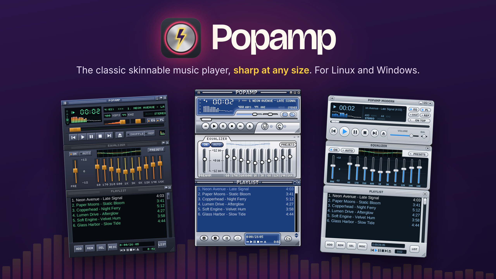
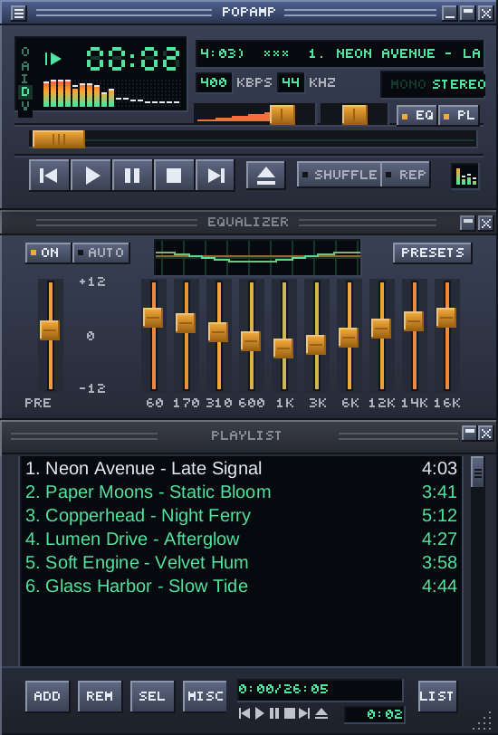
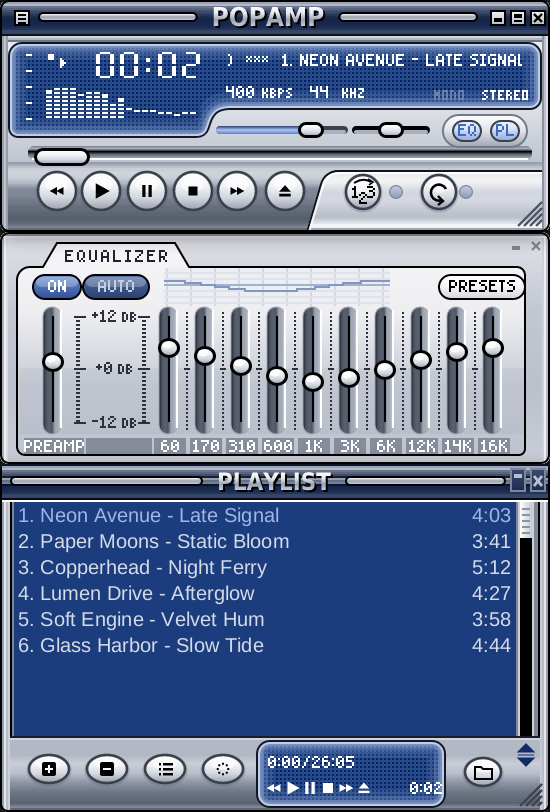
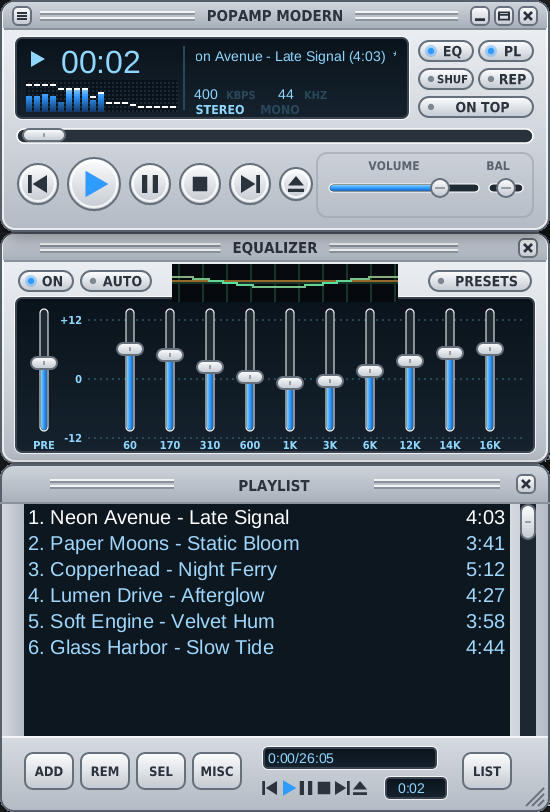
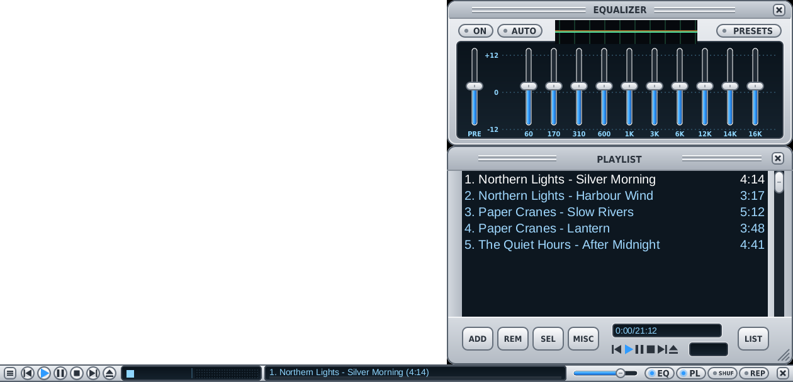

<p align="center">
  <a href="#install"></a>
</p>

<p align="center">
  <a href="https://github.com/popamp/popamp/actions/workflows/ci.yml"></a>
  
  <a href="#license"></a>
</p>

<p align="center">
  <b><a href="#install">Download</a></b> ·
  <a href="docs/features.md">Features</a> ·
  <a href="docs/usage.md">Usage</a> ·
  <a href="docs/skin-format.md">Make a skin</a> ·
  <a href="docs/ROADMAP.md">Roadmap</a>
</p>

Popamp is a desktop music player in the spirit of Winamp 2: a main
window, a 10-band equalizer and a playlist that snap together, and a
different look whenever you want one. It is written in Rust and runs on
Linux and Windows.

- **Sharp at any size.** Popamp's own skins are drawn as vectors, so they
  stay crisp from ×1 to ×3 in steps of a quarter, on any monitor.
- **Thousands of classic skins.** Open any `.wsz` file, or browse, search
  and install skins from the [Winamp Skin Museum](https://skins.webamp.org)
  without leaving the player.
- **Sounds right.** Gapless playback, ReplayGain, a 10-band equalizer
  with `.eqf` presets, internet radio, and the common formats: MP3, AAC, FLAC,
  Ogg Vorbis, WAV, ALAC and more.
- **At home on your desktop.** Media keys and the system's player
  controls show the track and its cover. A bar skin docks to the edge of
  the screen like a taskbar.
- **Plug-ins you allow.** Sandboxed WebAssembly plug-ins, each switched
  on by you: [YouTube](https://github.com/popamp/plugin-youtube) as a
  source, [Crossfeed](https://github.com/popamp/plugin-crossfeed) for
  headphones.
- **Your music stays yours.** No account, no cloud, no library to import:
  it plays files and the streams you open.

### Skins

| [Default](skins/default) (built in) | [Steel](https://github.com/popamp/skin-steel) | [Modern](https://github.com/popamp/skin-modern) |
|:---:|:---:|:---:|
|  |  |  |

[**Bar**](https://github.com/popamp/skin-bar): the whole player in one
strip along the bottom or top of the screen, with the equalizer and the
playlist above it.



## Why?

Popamp began with a search for Winamp on a Linux desktop. Two good
players written in Rust already existed,
[Linamp](https://github.com/sayoojkkarun/linamp) and
[Ferramp](https://github.com/SpankulatorX/ferramp), but both drew the
classic bitmap skins, and on a modern monitor with the desktop scaled up
those skins went soft and blurry, even at double size.

So Popamp took Linamp's code, brought over the best of Ferramp's
features, and added one new idea: skins drawn as vectors, sharp at any
size, fractional ones included. Classic skins got the same care. Then
came plug-ins that cannot reach more than you allow, and a Windows
version, so one player and its skins work on both systems.

## Install

Downloads are on the [Releases page](https://github.com/popamp/popamp/releases),
in two builds: **popamp**, the player, and **popamp-plus**, the player
with [plug-ins](docs/plugins.md) such as YouTube.

| System | Download |
|---|---|
| Debian, Ubuntu | `popamp-<version>-linux-amd64.deb` (ARM64: `-arm64.deb`): `sudo apt install ./popamp-…deb` |
| Any other Linux | `Popamp-<version>-linux-x86_64.AppImage`: `chmod +x` it and run it |
| Windows 10 or 11 | `Popamp-<version>-windows-x86_64.zip`: unpack it anywhere and run `popamp.exe` |

Or build it yourself with Rust 1.96 or newer:

```sh
git clone https://github.com/popamp/popamp.git && cd popamp
cargo build --release                      # add --features plugins for popamp-plus
./target/release/popamp ~/Music
```

### More

- [Features](docs/features.md): everything Popamp does, and what it does not do yet.
- [Usage](docs/usage.md): keys, remote control from the command line, where settings live.
- [Building and installing](docs/building.md): requirements, packages per distribution, installing from source.
- [Plug-ins](docs/plugins.md) and [the skin format](docs/skin-format.md), for making your own.
- [Testing](docs/testing.md): what was tested, where and how.
- [Contributing](CONTRIBUTING.md), [Changelog](CHANGELOG.md), [Roadmap](docs/ROADMAP.md).

## License

Popamp is free software under the [MIT](LICENSE-MIT) or
[Apache 2.0](LICENSE-APACHE) license, at your option; contributions are
taken under the same terms. Third-party crates keep their own licenses
(the Symphonia decoders are MPL-2.0), and code taken from Linamp and
Ferramp is listed in [THIRD_PARTY.md](THIRD_PARTY.md).

Popamp contains no Winamp code or artwork. Winamp is a trademark of its
owner; Popamp is an independent project and is not affiliated with or
endorsed by it.
