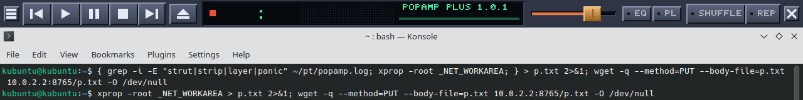
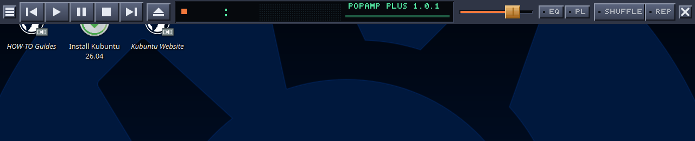
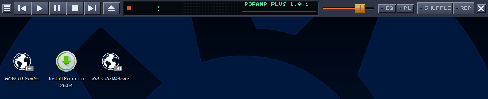

# Popamp on KDE Plasma

On a Plasma desktop on Wayland, Popamp runs as an X11 program through
Xwayland, as on Ubuntu. The windows dock, snap to each other and to the
screen's edges, and move together, as on X11. This page describes the
one place where Plasma behaves in a way you might not expect.

Checked on Kubuntu 26.04.1 (KDE Plasma 6.6.6, KWin 6.6.6, Xwayland
24.1.10), with Plasma's panel at the bottom of the screen as Kubuntu sets
it up.

## Toolbar mode at the top covers the desktop icons

Plasma's window manager keeps maximized windows out of the bar's strip,
at the top of the screen as well as at the bottom:

The desktop icons do not move out of the way. Plasma keeps room for
its own panels when it lays out the icons, but not for the panels and
bars of other programs. With the bar at the top, the first row of icons
is partly under it:

Popamp cannot change how Plasma lays out the icons. Restarting Plasma does not
help either. Instead, do one of the following:

- Drag the icons below the bar. Plasma keeps them where you put them.

  

- Keep the bar at the bottom of the screen. There it sits above Plasma's
  panel, and the icons, which start at the top, stay clear of it.

## After Plasma restarts, a maximized window can be under the bar

When Plasma's desktop shell restarts (after a crash or an update, or
with `plasmashell --replace`), a window that was maximized at the time
can end up with its top under the bar, although the room for the bar
is still kept. Maximize it again (double-click its title bar twice, or
press Meta+PgUp twice), and it starts right under the bar.

Moving the bar to the other edge, or turning toolbar mode off and on,
moves maximized windows out of its way as it should.
