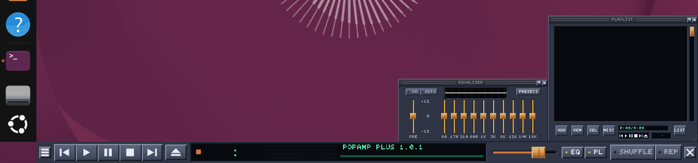
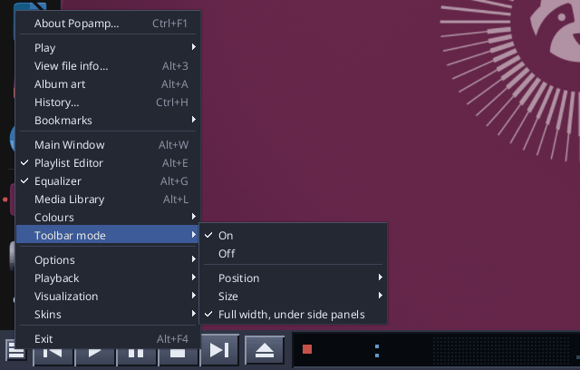
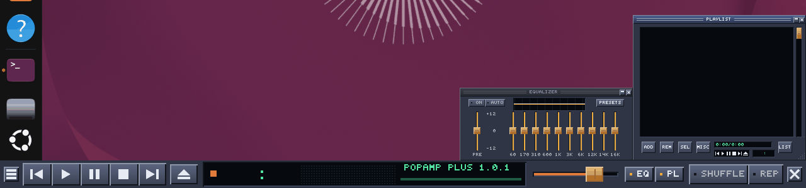

# Popamp on Ubuntu

Ubuntu's desktop is GNOME on Wayland, and Popamp runs on it as an X11
program through Xwayland. Its Xwayland lets a program place its own
windows, so everything works as on X11: the windows dock, snap to each
other and to the screen's edges, and move together. This page describes
the few places where Ubuntu, and its dock in particular, behaves in a way
you might not expect.

This page is about Ubuntu only. Other systems built on GNOME, such as
Zorin OS, have panels of their own that behave differently, and
unmodified GNOME has no dock at all, so what follows need not apply
there.

Checked on Ubuntu 26.04.1 (GNOME Shell 50.1, Mutter 50.1, Xwayland
24.1.10), with the Ubuntu Dock at the left of the screen as Ubuntu sets
it up.

## Toolbar mode leaves an empty corner beside the dock

When the bar is turned on at the bottom of the screen, Ubuntu's dock
gets shorter and ends above the bar. But the desktop still tells programs that
the dock takes the whole left edge of the screen, from top to bottom.
Popamp keeps its bar inside the room the desktop says is free, so the
bar starts right of the dock, and the corner under the dock stays empty:

The desktop does not tell programs that the corner is free now, so Popamp
cannot see it. You can tell Popamp yourself: Main menu > *Toolbar mode* >
*Full width, under side panels*.

 Toolbar mode, with Full width, under side panels checked">

The bar then spans the whole width of the screen, and the dock stays
above it:

The option is off at first. A side panel that does not make room for
the bar, as in some other desktops, would cover the bar's end, and the
buttons there could not be clicked. Turn it on where the dock makes room,
as Ubuntu's does.

## The bar is smaller than the size you chose

A bar wider than the screen would lose its buttons at the right end. So
Popamp shows the bar at the size you chose only if it fits across the
screen. If it does not, the bar takes the biggest smaller size that fits,
and *Toolbar mode* > *Size* offers only the sizes that fit.

On a 1280 pixel wide screen with the dock beside the bar, ×2 does not
fit and the bar shows at ×1.75. With *Full width, under side panels* on,
the bar gets the dock's width too and ×2 fits again. Popamp keeps the
size you chose: on a wider screen the bar is ×2 again.
